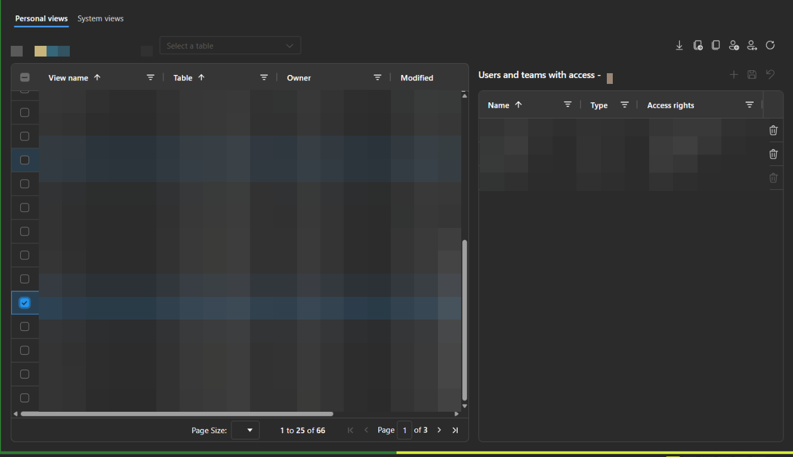

# View Manager

View Manager is a Power Platform ToolBox tool for browsing Dataverse personal and
system views, copying personal views into system views, and managing the users
and teams personal views are shared with.

Personal and environment-specific values are obscured in this screenshot.

## Getting started

1. Open Power Platform ToolBox and connect to your Dataverse environment.
2. Open View Manager inside ToolBox.
3. On the **Personal views** tab, use the owner filter to find personal views.
4. Select a personal view to see its sharing permissions, or switch to
   **System views** and select a table to browse its system views.

View Manager requires the ToolBox host and does not run as a standalone website.
The connected account must have permission to read the relevant views and
sharing records, and to change sharing if you want to edit access.
Paged Dataverse queries stop at 20 pages (up to 100,000 records); narrow a query
and retry if it exceeds that bound.

## What this tool changes

View Manager only changes Dataverse data after you select an explicit action
and confirm its target and scope. It can create personal or system view copies,
add copied system views to an unmanaged solution, reassign ownership of
personal views, and grant, modify or revoke direct sharing permissions. It does
not modify source view definitions when copying, publish customizations, or
change security roles.

Ownership and sharing changes can remove access or replace existing direct
permissions. Before changing them, use **Export selected views backup** to
download a JSON file containing the selected personal views' owners and direct
sharing records. Keep the backup in a secure location; it contains user and
team identifiers. Restoring a backup is not currently supported.

The tool does not send telemetry or view data to an external service. Its
Dataverse requests use the Power Platform ToolBox host APIs and the active
connection shown in each confirmation.

**AI disclosure:** View Manager is not an AI-powered tool. AI assistance was
used in development.

## Find personal views

The **Personal views** tab opens by default and contains all ownership and
sharing tools described below.

The owner filter defaults to the current user. Type in the filter to search for
another available user, or select **All owners** to browse by table. A second
searchable filter lists all tables by display name and logical name. Select a
table to show its personal views across all owners; the grid stays hidden until
a table is selected. Both filters are left-aligned in the header. Selecting a
specific owner keeps the table filter visible but disabled and
shows that owner's views across all tables.
Results are still limited by the connected account's permissions.

The left-hand grid shows each view's name, table, owner, last modified date and
description. It starts sorted by **Table**, then **View name**. You can change
sorting, filter columns and browse results using the pagination controls.
Use row checkboxes to select multiple views. The header checkbox selects all
views matching the grid filters, including those on other pages.

Use the **Refresh personal views** icon beside the owner filter to reload the
list for the current owner or table. Changing owner, changing table or refreshing
clears the selected view and access panel. Switching owners clears the table selection.
Use **Export selected views backup** to download ownership and sharing records
for selected personal views before making changes.

## Browse system views

1. Open the **System views** tab.
2. Search the table combobox by display name or logical name and select a table.
3. The grid lists that table's system views, showing name, table, modified date
   and description. Sort, filter columns or use pagination to browse the list.

No system-view query or grid is shown until a table is selected. Use the
**Refresh system views** icon to reload the selected table's views, or retry
loading tables if a metadata error is displayed.

Each tab keeps its own filters and results when you switch. Save or discard
pending personal-view edits and close bulk-action forms before switching tabs.
A connection change clears the system table selection. Results remain limited
by the connected account's permissions.

## Copy system views to personal views

1. On **System views**, select one or more views using the row checkboxes.
2. Click **Copy selected system views to personal views** in the toolbar.
3. Choose an active user as the new owner, review the views and target
   environment, then click **Confirm and copy views**. The original system
   views are unchanged.

Copy up to 100 views per operation. Each personal copy keeps its system view's
name, description, filters and layout.
Copies are separate views, so later changes to either view do not affect the
other. If a create request fails, **Retry remaining copies** uses the same copy
IDs and owner, checking whether Dataverse already created each view before
retrying. Closing the dialog does not undo views that Dataverse has already
created; after a failed attempt, the matching personal-view listing is refreshed
when it is visible.

## Copy views across environments

View Manager can connect to up to seven Dataverse environments. The primary
environment is always the source; up to six additional configured connections
are available as destinations. Select one or more destination environments in
the cross-environment copy dialog.

Use **Copy personal views to other environments** on the Personal views tab to
copy selected personal views as personal views. Each destination has its own
portrait card in a three-column, two-row layout: check the environment name to
include it, choose the new owner at the top of the card (the picker remains
visible but is disabled until the environment is checked; while its users load,
the picker is replaced with a loading indicator), and review the views
listed below. Use **Copy system views to other environments** on the System
views tab to copy selected system views as system views. Its cards likewise
list the views and keep the unmanaged-solution picker at the top (disabled
until the environment is checked, and replaced by a loading indicator while
solutions load). Review the selected views and destination environment, owner
or solution, then click **Confirm and copy views**.

Owner changes, backups and copy operations are limited to 100 selected views;
cross-environment copies are additionally limited to 500 total destination
copies.
Copies run sequentially; a green checkmark appears beside each completed view
in its destination card. If a copy fails, retry the remaining work in the same
dialog; completed copies are skipped and the selected destinations,
owners/solutions and copy IDs stay locked. Closing the dialog or changing
connections does not undo views already created. Cross-environment copying
requires the connected account to have the
appropriate read and create privileges in each environment, plus solution
privileges when copying system views.

## Copy personal views to system views

1. On **Personal views**, select **one or more views** using the row checkboxes.
2. Click the **Copy to system views** icon in the header. Its tooltip shows the
   selected count; it is disabled when nothing is selected.
3. Search for and select an **unmanaged solution**. The picker shows its display
   name, unique name and version. Managed, hidden and internal Active/Default
   solutions are excluded.
4. Review the public-view warning, selected views, solution and target
   environment, then click **Confirm and copy views**.

Each selected personal view becomes a new, non-default public system view for
the same table, with its original name, description, filters and layout.
Existing views are not overwritten, even if their names match. The original
personal views and their sharing permissions remain unchanged, and your grid
selection is preserved.

**System views are public, not private shares.** Access depends on users'
security roles. The connected account needs permission to read the source views,
create system views and add components to the selected solution. This action does
not publish customizations automatically: review and publish through the solution
as needed, and include the views in the appropriate model-driven apps.

Copy up to 100 views per operation. Copies run one at a time, with progress
shown in the form. On failure, **Retry
remaining copies** keeps the same solution and copy IDs. Completed copies are not
recreated. If a view was created but could not be added to the solution, its ID is
shown and retry attempts the solution addition again. Stable IDs also prevent a
lost creation response from producing a second copy on retry.

**Close** does not undo copies, including any not yet added to the solution.
An interrupted request may already have created a view; retry in the same form
to recover it. Starting a new operation creates new copies. Switching connections
or closing the tool discards the in-memory retry state and cannot cancel a write
already submitted. Check the original environment before starting another copy.
The System views list refreshes, if it already has a selected table, after a
completed batch or after closing a batch that was attempted.

## Change owners of selected views

1. Select **one or more views** using the row checkboxes.
2. Click the **Change owner** icon in the header; its tooltip shows the selected count and
   stays disabled when no views are selected.
3. Search for and select one new owner from the active users. Users who already
   own every selected view are excluded.
4. Review the current and new owners, then click **Confirm owner changes** or
   go back to leave ownership unchanged.

Reassign up to 100 views per operation.

The connected account needs permission to assign the view. Changing ownership
may remove your access to it. Assigning to teams is not supported by this picker.
Save or discard pending sharing changes before changing ownership.

Views are assigned one at a time; views already owned by the chosen user are
left unchanged. The dialog shows progress. On failure, processing stops and the
dialog reports how many views completed. **Retry remaining views** uses the same
owner and does not repeat successful assignments. **Close** leaves completed
changes in place; it does not undo them.

After assignment, the list reloads using the current filters and both row and
sharing selections are cleared. Views assigned to another user disappear from
the old owner's filtered list. If assignment succeeds but reloading fails, use
Refresh personal views; the ownership changes have already been saved.

## See who a view is shared with

Select exactly one row in the left-hand grid. The right-hand panel displays the users and
teams returned for that view, together with readable access rights such as
**Read**, **Write** and **Share**.

- The panel lists sharing records, not everyone who could access the view.
- Team members are not expanded into individual users.
- Ownership, security roles or membership of other teams may provide additional
  access that is not shown here.
- A warning appears when the query reaches its limit of **51 sharing records**;
  more records may exist.

## Add users to selected views

1. Select one or more views and click the **Add users** icon in the top bar.
2. Search for and select multiple active users. The selected names appear below
   the picker.
3. Choose the permissions to apply to every selected user on every selected view.
   **Read** is selected by default; at least one permission is required.
4. Review the replacement warning and affected users, views and permissions,
   then click **Confirm and apply access**.

**This replaces each selected user's existing direct sharing permissions with
exactly the selected permissions. Existing permissions not shown in the picker
are removed too.** For example, choosing only Read removes an existing direct
Write or Share grant. New users receive a new share. Access through ownership,
security roles or teams is unaffected; unselected users and views are unchanged.

The form shows this warning before you apply any changes. The connected account
must have the required sharing permissions.

The operation is limited to 500 user/view changes. Changes run one user/view
pair at a time. If an operation fails, the form shows
the affected user and view and how many changes completed. **Retry remaining
changes** keeps the same users and permissions and does not repeat completed
changes. **Close** after a partial failure does not undo changes already saved.
After completion, the view list reloads and selection is cleared. A reload
failure explicitly reports that access was saved; use Refresh to reload.

Finish or discard existing sharing edits before using this action. Filters,
selection and other top-bar actions are locked while the form is open.

## Add a user to one view's access panel

1. Select a personal view and click **Add user** in the access-panel header.
2. A new row is added at the bottom of the grid and a user picker opens.
3. Type to search, then select a user. Users already listed in the grid,
   including pending additions, are excluded.
4. The new user starts with **Read** access. Click their Access rights value to
   amend it if needed.
5. Use **Save access changes** to apply the new share.

**Cancel** removes an unfilled new row. **Discard access changes** removes
pending additions along with other unsaved edits. Clearing all rights for a
newly added, unsaved user removes that pending addition without changing
Dataverse. Adding teams is not currently supported by this picker.

## Remove a user's access

Click the **Delete** icon in a user's Actions column to mark their share for
removal. The row disappears immediately; click **Save access changes** to apply
the removal in Dataverse. Use **Discard access changes** to restore the row.

Delete revokes the entire direct share, including permissions hidden from the
editor. Access through ownership, security roles or teams may still apply.
Deleting a newly added, unsaved user only removes the pending addition.

## Change access rights

1. Click a user's or team's **Access rights** value.
2. In the editor's compact list box, select or clear permissions. All five
   choices are shown without opening a dropdown.
3. Select **Done** to return to the access panel. This does **not** save yet.
4. Repeat for other users or teams if needed.
5. Click the **Save access changes** icon in the access-panel header to save all
   pending edits for the selected view.

Use the **Discard access changes** icon to undo pending edits instead. The owner
and table filters, view selection and refresh are disabled while edits are pending or
saving, to prevent accidental loss of changes.

The picker offers **Read**, **Write**, **Delete**, **Share** and **Assign**.
Create, Append and Append to are hidden from the picker; any existing grants for
those permissions are preserved.

**Saving with no remaining permissions revokes that user's or team's share.**
Clearing the picker does not remove hidden permissions. Users may also still
have access through ownership, roles or other teams.

The unsaved-changes prompt appears below the access grid. After saving, the
panel reloads and ToolBox displays a success notification. Unsupported
permissions appear as **Unknown rights** and cannot be edited in this tool.

### If saving fails

The tool displays an error and retains edits that have not been saved. Changes
are saved one user or team at a time, so earlier changes may already have
succeeded. Check the message, then retry **Save** or discard the remaining edits.

If saving succeeds but reloading fails, the message explains that the changes
were saved. Refresh the personal views and select the view again to reload its
sharing records.

## Troubleshooting

- **No connection:** select an active Dataverse connection in ToolBox.
- **No views:** check the selected owner/table and any grid filters, or try All owners and select a table.
- **Tables failed to load:** use Refresh personal views to retry loading the table list.
- **No sharing records:** the selected view may have no returned shares; this
  does not mean nobody can access it.
- **Access denied:** check that the connected account has the required
  permissions. Editing the filter does not change which account makes requests.
- **Controls disabled:** finish saving or discard pending permission changes.

## Testing

Human acceptance testing was performed by LinkeD365 on 15/1/2026 using
View Manager 0.3.0 in Power Platform ToolBox 1.2.7 against a
real, non-production Dataverse environment.

- Light and dark themes: ✔️
- View listing and backup export: ✔️
- Ownership and sharing changes: ✔️
- Personal/system and cross-environment copies: ✔️
- Permission, connection-change and retry scenarios: ✔️
- Issues or limitations: none

## Technical documentation

For architecture, Dataverse APIs, local builds, testing and implementation
details, see [Technical implementation](IMPLEMENTATION.md).

## License

MIT
